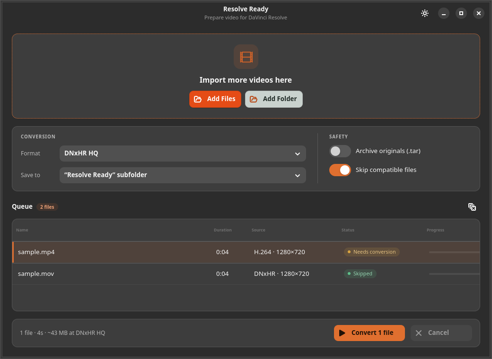

# Resolve Ready

**Resolve Ready** is a small GTK 4 application that converts footage into formats
**[DaVinci Resolve](https://www.blackmagicdesign.com/products/davinciresolve) on Linux**
can edit — without touching your originals.

Resolve Free on Linux cannot decode H.264, H.265 or AAC media. Resolve Ready
transcodes video to **DNxHR** or **ProRes**, converts audio to **24-bit PCM at
48 kHz**, writes a `.mov`, verifies the result, and keeps the source files safe.



<p align="center">
  <a href="https://github.com/mdshakibsami/resolve-ready/releases/latest">
    <strong>Download the latest release</strong>
  </a>
</p>

## Supported systems

| Package | Requirements | Tested on |
| --- | --- | --- |
| **AppImage** | x86_64 Linux with glibc 2.35+, FUSE 2 (or extract-and-run) | Ubuntu 22.04, 24.04, 26.04; Debian 12, 13 |
| **.deb** | Python 3.10+, GTK 4.6+, libadwaita 1.1+, ffmpeg | Ubuntu 22.04, 24.04, 26.04; Debian 12, 13 on amd64 |

All Ubuntu 22.04.x point releases are supported on amd64. Debian 12 and 13 are
tested. Newer Ubuntu/Debian releases and derivatives are expected to work when
they meet the dependency minimums above, but are not guaranteed until tested.

The AppImage is built on Ubuntu 22.04 with a static LGPL ffmpeg and bundles
Python, GTK 4, libadwaita and the application icons. It is expected to work on
other glibc 2.35+ distributions such as Fedora 36+ and Arch Linux. The `.deb` is
pure Python (`Architecture: all`), but only amd64 has been tested; other
architectures may work when all runtime dependencies are available.

> Resolve Ready is an independent project. It is not affiliated with or
> endorsed by Blackmagic Design. DaVinci Resolve is a trademark of Blackmagic
> Design.

## Download and install

Get both packages from the
[latest GitHub release](https://github.com/mdshakibsami/resolve-ready/releases/latest).
`SHA256SUMS` is published next to them.

### AppImage — recommended for most distributions

```bash
chmod +x ResolveReady-1.1.2-x86_64.AppImage
./ResolveReady-1.1.2-x86_64.AppImage
```

The AppImage needs FUSE 2. On Debian 12 and Ubuntu 22.04 install it once with:

```bash
sudo apt install libfuse2
```

On releases with the 64-bit time_t transition, such as Ubuntu 24.04+ and
Debian 13, the package is named `libfuse2t64`:

```bash
sudo apt install libfuse2t64
```

If FUSE is unavailable (containers, locked-down systems), run it with:

```bash
./ResolveReady-1.1.2-x86_64.AppImage --appimage-extract-and-run
```

### Debian / Ubuntu

```bash
sudo apt install ./resolve-ready_1.1.2_all.deb
resolve-ready
```

The `.deb` uses the distribution's `ffmpeg`, Python, GTK 4 and libadwaita
packages. It has a GTK 4.6 / libadwaita 1.1 feature-detection layer, so the same
file works on the tested Ubuntu and Debian releases above and is expected to
work on newer releases that provide the same packages.

## Features

- Drag and drop individual files or whole folders (recursive)
- Detects media Resolve can already read and skips it by default
- DNxHR SQ / LB / HQ / HQX presets
- ProRes 422 Proxy / LT / 422 / HQ presets
- 24-bit PCM audio at 48 kHz
- Output to a `Resolve Ready/` subfolder (default), next to the source, or a
  custom folder
- Per-file and overall progress, with cancellation
- Verifies codec, resolution, frame rate, duration, audio format and file size
- Keeps originals; optional `.tar` backup
- Summary dialog with a **See Files** shortcut after a batch
- Dark and light appearance
- Remembers settings in `~/.config/resolve-ready/settings.json`
- Command-line start with files or folders: `resolve-ready clip.mp4 footage/`

## How it works

1. `ffprobe` reads the source and decides whether a conversion is needed.
2. `ffmpeg` writes a temporary DNxHR/ProRes `.mov` with PCM audio.
3. The output is probed and compared with the preset.
4. Only a verified file is moved into place. The source is never modified.

## Build from source

### Run directly

Install the runtime packages (names for Debian/Ubuntu):

```bash
sudo apt install python3-gi gir1.2-gtk-4.0 gir1.2-adw-1 ffmpeg
PYTHONPATH=src python3 -m resolve_ready
```

### Build the .deb

```bash
./packaging/build_deb.sh
sudo apt install ./dist/resolve-ready_1.1.2_all.deb
```

### Build the AppImage

Docker is required. The build compiles a minimal static LGPL ffmpeg and then
packages the app in an Ubuntu 22.04 container:

```bash
./packaging/build_appimage.sh
./packaging/verify_appimage.sh ./dist/ResolveReady-1.1.2-x86_64.AppImage
./dist/ResolveReady-1.1.2-x86_64.AppImage
```

The verification step uses the AppImage's own bundled Python and FFmpeg to
encode a synthetic H.264/AAC clip through every DNxHR preset and ProRes 422,
then compares the decoded frames with the source. It requires host `ffmpeg`,
`ffprobe` and `python3`. Build artifacts go to `dist/` and are never committed.

## Tests

The suite uses only the standard library plus `ffmpeg`/`ffprobe`:

```bash
python3 -m unittest discover -s tests -v
```

It generates small H.264/AAC clips and round-trips them through DNxHR and
ProRes, including silent sources and a 44.1 kHz audio case. The current suite
has 23 tests.

CI runs the suite and package validation on Ubuntu 22.04, 24.04 and Debian 12,
13. Release builds are also exercised end-to-end with real 1280×720 H.264
clips and an AAC source on clean systems, and the release workflow verifies
the AppImage's frame quality against its source before publishing.

## Project layout

```
src/resolve_ready/       application, GTK UI, compatibility layer
src/resolve_ready/core/  probing, presets, encoding, verification, settings
assets/                  desktop entry, AppStream metadata, icons, screenshot
packaging/               .deb and AppImage build scripts and recipes
tests/                   unittest suite
```

## Contributing

Bug reports and feature requests are welcome in
[GitHub Issues](https://github.com/mdshakibsami/resolve-ready/issues). For code
changes, keep the existing structure and add or update tests where behaviour
changes.

## Disclaimer

Resolve Ready is provided as-is, without warranty. Video conversion is
CPU-intensive and output files can be large. Always keep backups of important
media, and test a short clip in Resolve before converting an entire project.
Report security issues privately through
[GitHub's private vulnerability reporting](https://github.com/mdshakibsami/resolve-ready/security/advisories/new).

## License

Resolve Ready is released under the [MIT License](LICENSE).

The AppImage contains a statically linked **LGPL** build of FFmpeg 6.1.2
(configured with `--disable-gpl --disable-nonfree`), plus GTK, libadwaita,
Python and their dependencies under their respective licenses. See
[THIRD_PARTY_NOTICES.md](THIRD_PARTY_NOTICES.md) and the copyright files inside
the AppImage under `/usr/share/doc/`.
